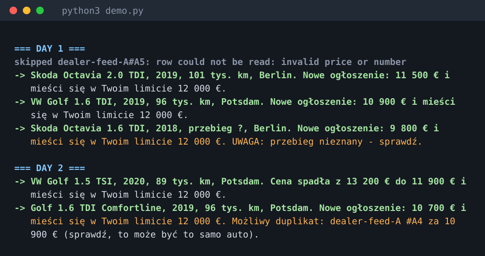

# DealSpotter

Watches used-car listings for a small dealer or a car buyer and sends a short
message when something **new** fits the criteria or a price **drops into the
budget**. Built to be careful: it says what it does not know instead of guessing.



## The problem

A buyer who looks for "VW Golf, up to 12 000 €, 2018 or newer, near Potsdam" has
to reload several sites all day. Good offers are gone in hours, a price drop
is easy to miss, and the same car shows up on three sites under three titles.

## What it does

- **Criteria**: models, max price, min year, max mileage, regions (`criteria_demo.json`).
- **New vs. price drop**: a listing is identified by *source + listing id*. A repeat
  read is silent; a lower price, or a price that falls into the budget, is its own alert.
- **Never guesses**: a missing mileage or year does not reject the car. It is
  reported with `UWAGA: przebieg nieznany - sprawdź`. A row whose price cannot be read
  is listed as skipped with the reason, not dropped silently.
- **Possible duplicates**: the same make/model/year/region with similar mileage and
  price on another source is *flagged* in the alert, never hidden (it could be a
  different car).
- **Client statuses**: `nowe` / `do_kontaktu` / `sprawdzone` / `odrzucone`.
  Reads never overwrite a status; a listing marked `odrzucone` stays quiet.
- **Alerts never lost**: written to an outbox first, marked as sent only after
  Telegram accepted them. A failed send is retried on the next run.

## Data source (important)

DealSpotter does **not** scrape mobile.de, AutoScout24 or similar portals: their
terms forbid automated reading. It reads a JSON feed you are allowed to use (a
dealer export, a partner feed or an official API). The format is in `demo.py`.
Another source is a small adapter that returns the same listing shape.

## Run it (no network needed)

Python 3.9+, standard library only.

```
python3 demo.py
python3 -m unittest discover -s tests

python3 -m dealspotter run --criteria criteria_demo.json --feed feed_a.json feed_b.json
python3 -m dealspotter status "dealer-feed-A|A2" do_kontaktu
TELEGRAM_TOKEN=... TELEGRAM_CHAT_ID=... python3 -m dealspotter run --criteria criteria_demo.json --feed feed_a.json --telegram
```

## Layout

| Path | Purpose |
| --- | --- |
| `dealspotter/feed.py` | Reads a JSON feed; tolerant price formats; reports unreadable rows |
| `dealspotter/match.py` | Criteria check with "to verify" flags for unknown values |
| `dealspotter/dupes.py` | Cross-source possible-duplicate detection |
| `dealspotter/store.py` | SQLite: seen listings, client status, alert outbox |
| `dealspotter/monitor.py` | One run (new / drop / now matches) and outbox delivery |
| `dealspotter/telegram.py` | Telegram sender (HTTP injectable) |
| `tests/` | 17 tests, including failed delivery, status preservation, duplicates |

## Honest limits (v1)

- Demo data is **synthetic**. Telegram sending is tested with a fake HTTP call and
  has not been run against the live API from here.
- Alert texts are in Polish only; prices in EUR only.
- Duplicate detection is a heuristic and only flags; it needs known year and mileage on both sides.
- Reading is feed-based: no browsing of portals, no images, no VIN lookup.
